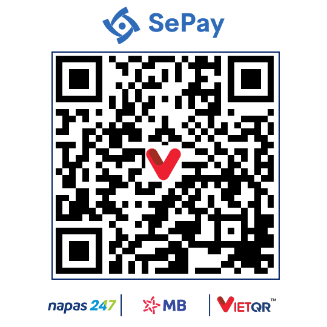

<div align="center">

# spx-seller-api

**Unofficial SPX (Shopee Express Vietnam) seller API for Node.js**

Log in to the spx.vn seller portal, read the COD wallet and its transactions, list shipments, download labels,
bulk-create shipments and track parcels.

[](https://www.npmjs.com/package/spx-seller-api)
[](LICENSE)
[](package.json)

</div>

> [!WARNING]
> This project is not affiliated with or endorsed by SPX Express or Shopee. It relies on the undocumented APIs behind
> `spx.vn`, which can change at any time. Automating a seller account may violate SPX's terms — use at your own risk.

## Table of Contents

- [Features](#features)
- [Installation](#installation)
- [Quick Start](#quick-start)
- [Authentication](#authentication)
- [API Reference](#api-reference)
- [Error Handling](#error-handling)
- [Examples](#examples)
- [Contributing](#contributing)
- [Support Us](#support-us)
- [License](#license)

## Features

- 🔐 Seller portal login through headless Chrome, with human-solved challenge support (SMS OTP, captcha)
- 💰 COD wallet balance and transaction history
- 📋 Shipment list and shipping labels (PDF)
- 📦 Bulk shipment creation through the portal's own Excel import — the portal validates and prices every row
- 🚚 Public parcel tracking — no session needed
- 📦 Written in TypeScript, ships type definitions — works with both ESM (`import`) and CommonJS (`require`)

## Installation

```bash
npm install spx-seller-api
```

Requires **Node.js 22+**. Logging in and bulk creation need a local Chrome or Chromium; API calls with a saved
session and tracking do not.

## Quick Start

```ts
import { SpxClient, getTracking, loginSpx } from 'spx-seller-api';

const session = await loginSpx({ username: '0901234567', password: '••••••' }, { chromePath: '/usr/bin/chromium' });

const spx = new SpxClient(session);
const me = await spx.baseInfo();
const wallet = await spx.balance(String(me.account_id));

const parcel = await getTracking('SPXVN0123456789');
console.log(parcel.statusGroup, parcel.records[0]?.name);
```

## Authentication

### Logging in

`loginSpx` fills in the `account.spx.vn` login form in headless Chrome and resolves with an `SpxSession` (`cookie`,
`userAgent`). The credential is the `spx_token` cookie. Save the session and reuse it until SPX reports it expired.

| Option | Type | Default | Description |
|---|---|---|---|
| `chromePath` | `string` | — | Path to Chrome / Chromium (required) |
| `onChallenge` | `(remote) => void` | — | SPX asks for an extra step — hand `remote` to a person |
| `challengeMs` | `number` | `300000` | Time allowed for the extra step |
| `onEvent` | `(e) => void` | — | Progress: `step` · `challenge` |
| `profileDir` | `string` | — | Persistent Chrome profile, so SPX recognises the device |
| `signal` | `AbortSignal` | — | Cancel the login |
| `timeoutMs` | `number` | `120000` | Time before any extra step |
| `userAgent` | `string` | — | Browser user agent |

Wrong credentials fail fast with `LOGIN_FAILED` (`status` = SPX account error code, e.g. `48401004`).

### Challenges

When SPX shows an extra step after the password (SMS OTP, captcha, device check), the library keeps the browser open
and passes an `SpxRemote` to `onChallenge`. Show its screenshots to a person and forward their input — the library
never solves challenges itself. Without `onChallenge` the login fails with `OTP_REQUIRED`.

| Method | Description |
|---|---|
| `screenshot()` | JPEG frame of the login page |
| `click(x, y)` | Click at a 0–1 relative position |
| `type(text)` / `key(key)` | Keyboard input |
| `drag(points)` | Replay a drag gesture (slider puzzles) |

## API Reference

`new SpxClient(session, options?)` — `logger?: (level, msg) => void`.

| Method | Returns | Description |
|---|---|---|
| `baseInfo()` | `object` | Account info (`account_id`, `store_name`, `user_name`, `phone_number`) — also a session check |
| `balance(accountId)` | `object` | Wallet: `balance`, `received_amount`, `paid_amount`, `frozen_balance` (strings) |
| `transactions({ bizAccountId, offset?, size?, types? })` | `object` | Wallet transactions (`types: [1]` = COD credited) |
| `listOrders({ offset?, pageSize? })` | `object` | Shipments, newest first |
| `label(orderSns)` | `Buffer` | Shipping label PDF by `order_sn` (not the tracking number) |
| `call(path, { method?, body?, query? })` | `data` | Any `/shipment/*` API, `retcode` checked |

### Bulk shipment creation

`createMassOrders(session, input)` opens `spx.vn/spx-admin/mass-order/create` in headless Chrome, clears leftover
drafts, selects drop-off, imports your `.xlsx` (SPX's mass-order template) and only clicks **Create** when the portal
reports exactly `expect` ready rows and no invalid ones.

| Input | Description |
|---|---|
| `chromePath` | Path to Chrome / Chromium |
| `base64` · `filename` | The `.xlsx` file |
| `expect` | Number of rows — any mismatch stops before creating anything |
| `dryRun` | Import and read the counts, never click Create |

Returns `{ submitted, ready, invalid, dropOff, reason }` — `reason` explains why nothing was submitted.

### Tracking

| Function | Returns | Description |
|---|---|---|
| `getTracking(trackingNumber, { timeoutMs?, userAgent? })` | `SpxTracking` | Public tracking, no session |
| `trackingUrl(trackingNumber)` | `string` | Public tracking page (`https://spx.vn/track?…`) |

`SpxTracking`: `statusGroup` (`Pending` · `In Transit` · `Delivered` · `Cancelled` · `Returned`…), `records[]`
(`code`, `name`, `description`, `time`, `visible`, `location`, newest first), `pickedUpAt` (`F100`, else the earliest
scan other than `F000`) and `deliveredAt` (`F980`) — times in unix seconds.

## Error Handling

All library errors are instances of `SpxError` with a `code` (and `status` when available):

| Code | Meaning |
|---|---|
| `SESSION_EXPIRED` | 401/403 or a login-related `retcode` — log in again |
| `API_ERROR` | `retcode` ≠ 0; `status` is the retcode |
| `HTTP_ERROR` · `NETWORK` · `BAD_RESPONSE` | Request failed |
| `LOGIN_FAILED` | Wrong credentials, Chrome failed to start, login form not found… |
| `OTP_REQUIRED` | SPX asked for an extra step and `onChallenge` was not provided |
| `LOGIN_ABORTED` | Cancelled through `signal` |

```ts
import { SpxError } from 'spx-seller-api';

try {
  await spx.baseInfo();
} catch (err) {
  if (err instanceof SpxError && err.code === 'SESSION_EXPIRED') {
    // log in again
  }
}
```

## Examples

| File | What it shows |
|---|---|
| [`login-and-save-session.ts`](examples/login-and-save-session.ts) | Log in and save the session to a JSON file |
| [`wallet.ts`](examples/wallet.ts) | Print the wallet balance and the latest COD transactions |
| [`track.ts`](examples/track.ts) | Track a parcel |

Run them with `npx tsx examples/<file> …`. Session files hold live cookies — never commit them.

## Contributing

Issues and pull requests are welcome — see [CONTRIBUTING.md](CONTRIBUTING.md). Protocol notes for maintainers are in
[docs/PROTOCOL.md](docs/PROTOCOL.md).

```bash
npm install
npm test       # unit tests, no network
npm run build
```

## Support Us

- ⭐ **Star the repository** if you find it useful
- 🔄 **Share** it with others
- 💡 **Contribute** ideas and code
- ☕ **Buy me a coffee** — VietQR (MB Bank · `0776750418`)



## License

[MIT](LICENSE)
